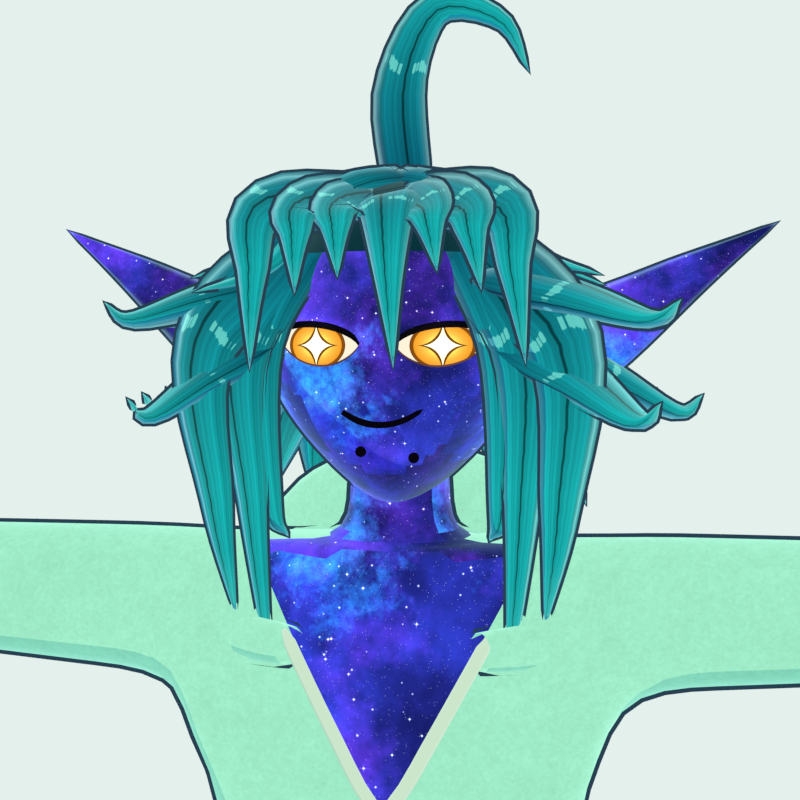
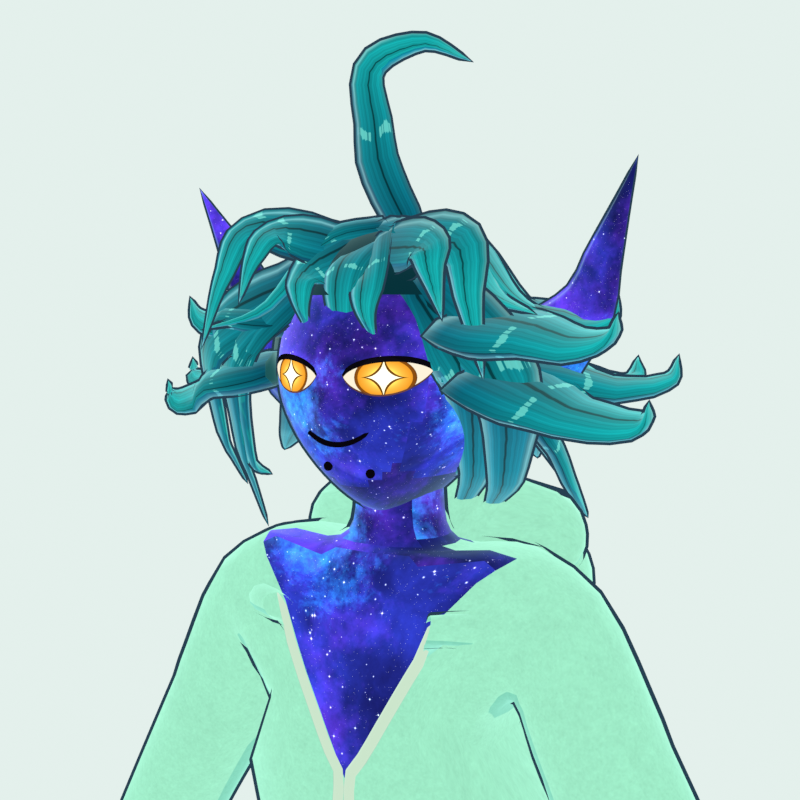
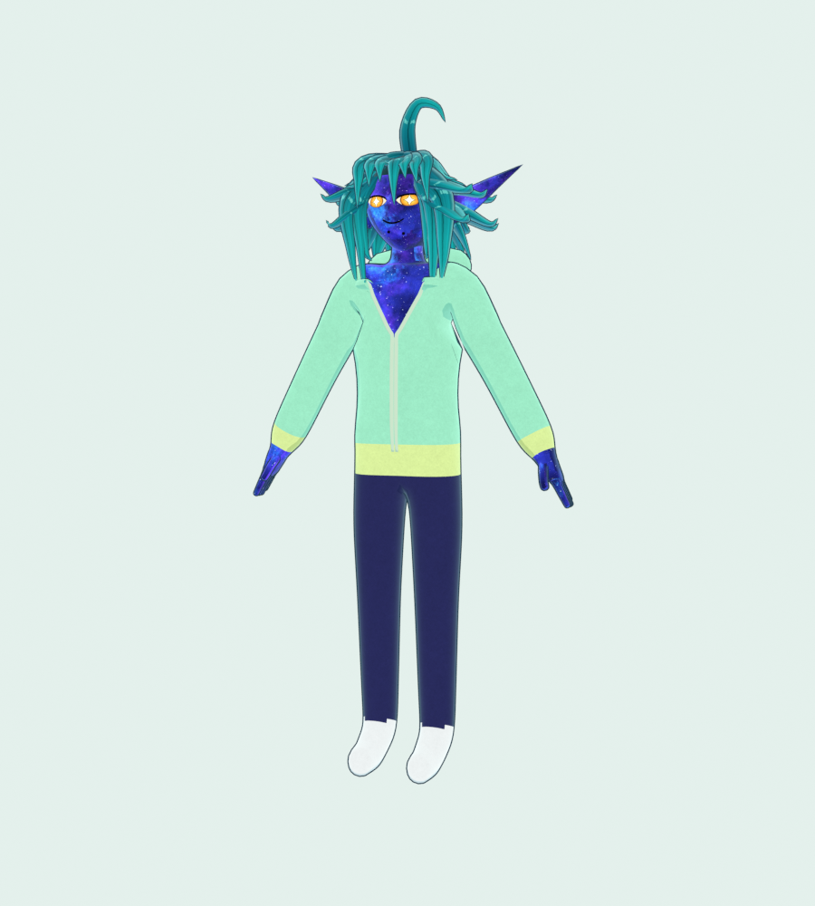
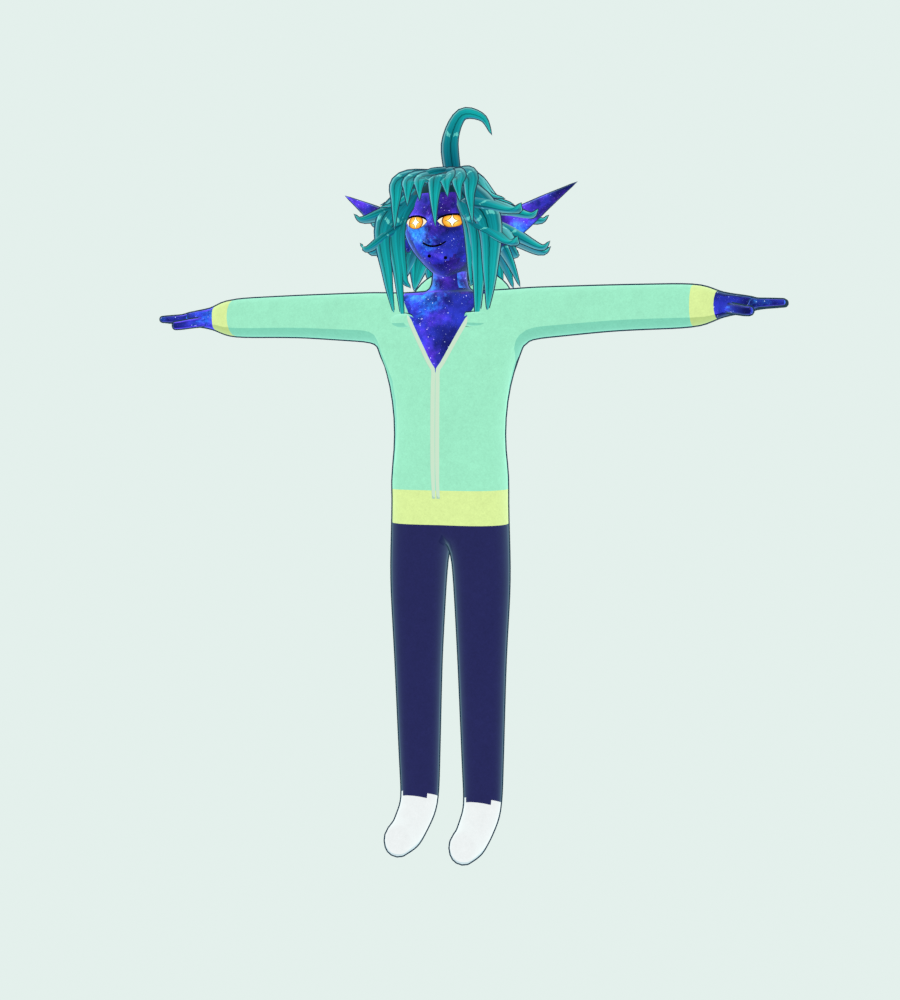

# Sternenelf – eigener BONELAB-Avatar

Ein Custom-Avatar für BONELAB nach deinem Profilbild: Haut wie eine Galaxie, türkise, wilde
Haare mit Antenne, lange Elfenohren, leuchtende goldene Sternenaugen, schiefes Lächeln mit zwei
Kinn-Piercings und ein mintgrüner Hoodie mit offenem Reißverschluss.
Im Anime-Look mit Konturlinien, harten Schatten und matten Haaren statt Plastik-Glanz.

| Porträt | Haar-Rig-Test (Ketten gebogen) | Arme-Rig-Test | T-Pose |
|---|---|---|---|
|  |  |  |  |

Die Vorschaubilder bildet Blender mit einer Nachbildung des Toon-Shaders nach. In Unity
sieht es mit `SternenElf/Toon` sehr ähnlich aus, mit URP/Lit etwas realistischer.

## Was ist drin?

| Datei | Inhalt |
|---|---|
| `export/SternenElf.fbx` | Fertiges Modell mit Skelett, Haar-Rig und eingebetteten Texturen |
| `export/SternenElf.blend` | Dieselbe Szene für Blender, zum Weiterbearbeiten |
| `export/textures/` | Alle Texturen als PNG (Galaxie-Haut, Augen, Haare, Stoffe, dazu Emissions-Maps) |
| `unity/Shaders/SternenElfToon.shader` | Anime-Toon-Shader für URP (BONELAB) |
| `unity/Editor/SternenElfSetup.cs` | Unity-Helfer: richtet Import und Materialien ein und erstellt das Prefab |
| `generate_avatar.py` | Skript, das alles oben neu erzeugt |

### Technische Daten

- **Größe:** ca. 1,80 m (mit Antenne 1,93 m), T-Pose
- **Körper-Skelett:** 52 Knochen im Mixamo-Namensschema mit Fingern, damit Unity es sofort als
  **Humanoid** erkennt
- **Haar-Rig:** 29 zusätzliche Knochen, alle Kinder von `Head`:

  | Kette | Knochen | bewegt |
  |---|---|---|
  | `Hair_Ahoge_1–3` | 3 | die Antenne oben |
  | `Hair_Bangs_L/C/R_1–2` | je 2 | Pony links, Mitte, rechts |
  | `Hair_Front_L/R_1–3` | je 3 | die langen Strähnen vorne bis zur Brust |
  | `Hair_Side_L/R/Back_1–2` | je 2 | die abstehenden Seitensträhnen |
  | `Hair_Nape_L/R_1–2` | je 2 | Nackenhaare |
  | `Ear_L/R_1–2` | je 2 | die Elfenohren (für Ohrenwackeln) |

  Die Gewichte verlaufen weich entlang jeder Strähne: Die Wurzel sitzt fest am Kopf, zur
  Spitze hin übernimmt Knochen für Knochen. Das Bild „Haar-Rig-Test“ zeigt alle Ketten gebogen.
- **Drei Meshes:** `Body`, `Head` (Gesicht und Ohren) und `Hair`. BONELAB blendet Kopf und Haare
  in der Ego-Perspektive aus, deshalb sind sie getrennt.
- **Kontur (Inverted Hull):** In jedem Mesh steckt eine leicht vergrößerte Hülle mit umgedrehten
  Flächen und dem Material `Outline`. Das funktioniert mit **jedem** Shader, auch mit URP/Lit.
- **Dreiecke:** ca. 72.000 mit Kontur, ca. 37.000 ohne. Für PC passt beides. Für die Quest
  empfehle ich die Variante ohne Kontur (siehe „Anpassen“).

## Nicht plastikartig: welcher Shader?

Die offizielle Marrow-SDK-Anleitung empfiehlt **Universal Render Pipeline/Lit** und warnt,
dass Shader, die nicht zu URP passen, den Avatar unsichtbar machen können. Deshalb gibt es
zwei Wege, und der Helfer fragt dich, welchen du willst:

| | **SternenElf/Toon** (eigener Shader) | **URP/Lit** (offiziell empfohlen) |
|---|---|---|
| Look | Anime: harte Schattenkante, farbige Schatten, Randlicht, Glanzring im Haar, funkelnde Sterne auf der Haut | realistischer, aber matt eingestellt (niedrige Glätte) |
| Licht | funktioniert auch in gebackenen Levels (Light Probes und feste Toon-Lichtrichtung) | normale BONELAB-Beleuchtung |
| Risiko | in BONELAB nicht getestet, siehe unten | sicher |

Der Toon-Shader ist ein reiner URP-Shader (HLSL mit den URP-Includes) und unterstützt
Single-Pass-Stereo für VR auf PC und Quest. **Ich konnte ihn hier nicht in Unity oder BONELAB
testen.** Falls der Avatar im Spiel unsichtbar ist oder rosa erscheint: Helfer erneut ausführen,
„URP/Lit“ wählen und neu packen. Kontur und matte Haartextur bleiben auch dann erhalten.

Die wichtigsten Regler im Toon-Material:

- *Schattenfarbe* und *Schattengrenze* bestimmen, wie dunkel und farbig die Schattenseite ist.
- *Randlicht* ist der helle Saum an den Kanten (wie im Bild der helle Rand an Haaren und Hoodie).
- *Glanzring für Haare* nur beim Material `Hair`. *Verschiebung* schiebt den Ring hoch oder runter.
- *Funkeln* nur bei `Skin_Galaxy`: Die Sterne auf der Haut pulsieren leicht.

## Haarphysik: was geht, was nicht

Das Haar ist fertig geriggt. Die Knochen und Gewichte stecken im Modell, du kannst die Strähnen
in Unity oder Blender posieren und animieren.

**Automatisch mitschwingen** tun die Haare in BONELAB aber nicht von allein. Die offizielle
Avatar-Anleitung des Marrow SDK beschreibt keine Haar- oder Jiggle-Physik (es gibt nur
Soft-Body-Regler für den Körper). Ich habe deshalb keine Physik-Bastellösung eingebaut, die im
Spiel kaputtgehen könnte. Wenn es in der BONELAB-Community eine Jiggle-Lösung gibt, die du
nutzen willst, sind die Ketten oben genau dafür vorbereitet: einfach die jeweils ersten Knochen
(`Hair_*_1`, `Ear_*_1`) als Wurzel eintragen.

## In BONELAB bringen (Schritt für Schritt)

### 1. Unity und Marrow SDK

1. **Unity Hub** installieren und darüber die Unity-Version, die das **Marrow SDK** verlangt
   (steht in dessen Readme). Für Quest zusätzlich **Android Build Support** mit installieren.
2. Das offizielle **Marrow SDK** von Stress Level Zero (GitHub: `StressLevelZero/MarrowSDK`)
   so installieren, wie es dort beschrieben ist.

### 2. Dateien in Unity kopieren

In deinem Unity-Projekt einen Ordner `Assets/SternenElf/` anlegen und hineinziehen:

- `export/SternenElf.fbx` und den Ordner `export/textures/` nach `Assets/SternenElf/`
- den Ordner `unity/` nach `Assets/SternenElf/unity/`
  (darin liegen der Shader und unter `Editor/` der Helfer)

### 3. Import und Materialien (automatisch)

1. Im Project-Fenster `SternenElf.fbx` anklicken.
2. Menü **Tools → Sternenelf → 1. Import + Materialien einrichten** und den Shader wählen.

Das stellt die Import-Einstellungen aus der Marrow-Anleitung ein (Humanoid, „Create From This
Model“, Skin Weights „Standard (4 Bones)“, Strip Bones, Blend Shapes, Weld Vertices). Außerdem
legt es unter `Assets/SternenElf/Materials/` alle Materialien mit den richtigen Texturen an:
die Kontur als schwarzes URP/Unlit, die Augen leuchtend, die Haare matt.

Danach im Reiter **Rig → Configure…** kurz prüfen, ob alle Knochen grün sind.

<details><summary>Lieber von Hand?</summary>

- **Rig:** *Animation Type* **Humanoid**, *Avatar Definition* **Create From This Model**,
  *Skin Weights* **Standard (4 Bones)**, *Strip Bones* an
- **Model:** *Tangents* **Calculate Mikktspace** (braucht der Haarglanz)
- **Materials:** pro Material den Shader auf `SternenElf/Toon` oder
  `Universal Render Pipeline/Lit` stellen und die gleichnamige Textur aus `textures/` als
  *Base Map* setzen. Bei URP/Lit die *Smoothness* auf etwa 0,15–0,3 stellen (das verhindert
  den Plastik-Look). Bei `Eyes` und `Skin_Galaxy` *Emission* einschalten und die
  `*_emission.png` eintragen.
- **Outline:** `Universal Render Pipeline/Unlit`, Farbe fast schwarz.

</details>

### 4. Prefab und Avatar-Script

1. `SternenElf.fbx` auswählen, dann **Tools → Sternenelf → 2. Prefab mit EyeCenterOverride
   erstellen**. Das legt das Prefab an und setzt `EyeCenterOverride` zwischen die Augen.
   Das Modell hat keine Augenknochen, und laut Marrow-Anleitung braucht BONELAB dann diesen Punkt.
2. Am Prefab **Add Component → Avatar** (das Avatar-Script aus dem Marrow SDK) und eintragen:
   - **Body Meshes:** `Body`
   - **Head Meshes:** `Head`
   - **Hair Meshes:** `Hair`
3. Mit **Edit Body** die Körper-Gizmos an das Mesh anpassen. Mit **Eye Offset** dafür sorgen,
   dass der grüne Punkt (die Kamera) nicht im Kopf steckt.
4. **Overrides → Apply All**. Der Crate nutzt das Prefab aus dem Project-Fenster, nicht das in
   der Szene.

### 5. Packen und installieren

1. **Asset Warehouse** öffnen, eine **Pallet** anlegen, **Add Crate → Avatar Crate** und dein
   Prefab eintragen.
2. **Generate Packed Assets**, dann **Pack Pallet** (für PC bzw. Android/Quest).
3. Den fertigen Ordner kopieren nach:
   - **PC:** `C:\Users\<Name>\AppData\LocalLow\Stress Level Zero\BONELAB\Mods`
   - **Quest:** `Android\data\com.StressLevelZero.BONELAB\files\Mods`
4. Im Spiel eine Map außer dem Hauptmenü betreten, **B oder Y** halten, **Avatars** wählen,
   und dort die Sternenelfe aussuchen.

## Anpassen

```bash
# mit installiertem Blender (4.2 oder neuer)
blender -b -P generate_avatar.py -- --out export

# oder ohne Blender-Oberfläche mit dem Python-Modul bpy (Python 3.13)
pip install bpy
python generate_avatar.py --out export
```

| Option | Wirkung |
|---|---|
| `--no-outline` | ohne Konturhülle, halbiert die Dreiecke (empfohlen für Quest) |
| `--no-render` | überspringt die Vorschaubilder, deutlich schneller |

Stellen im Skript:

| Was | Wo |
|---|---|
| Hoodie-, Hosen- und Schuhfarbe | `cloth_texture("hoodie", (0.62, 0.92, 0.78))` usw. (RGB von 0 bis 1) |
| Haarfarbe, Strähnenlinien, Glanzring | `hair_texture()` |
| Galaxie-Farben, Anzahl der Sterne | `galaxy_texture()` |
| Augenform, Iris und Stern | `lid_top`, `lid_bot`, `eye_texture()` |
| Konturdicke | `add_outline(bm, 0.0035)` (Körper) und `make_part(…, 0.0022/0.0025)` (Kopf, Haare) |
| Haarketten (wie viele Knochen pro Strähnengruppe) | `CHAIN_BONES.update(...)` im Abschnitt „Haare“ |
| Länge der Ohren | Abschnitt „Elfenohren“ (letzter Punkt = Ohrspitze) |

## Bekannte Grenzen

- Das Modell ist komplett per Code gebaut, also stilisiert und nicht handmodelliert.
- Es gibt keine Blendshapes (Mimik oder Lippenbewegung). BONELAB braucht keine.
- Die Haare sind geriggt, schwingen in BONELAB aber nicht von allein mit (siehe „Haarphysik“).
- Toon-Shader und Unity-Helfer wurden hier nicht in Unity oder BONELAB getestet.
